# Flowchart Aplikasi LMS (Multi-Role)

Role: **Siswa, Guru, Karyawan, Kepala Sekolah, Kepala Yayasan, Admin TU, Superadmin**

Isi dokumen:
1. Alur Umum (Login, RBAC, Dashboard)
2. Alur Fitur per Role (7 diagram)
3. Alur Akses Data (Role, Service, Database)
4. Matriks Hak Akses (CRUD)
5. Alur Proses Lintas Role (Tugas, Nilai, Raport)
6. Fallback ASCII (jika Mermaid tidak ter-render)

---

## 1. Alur Umum: Login, RBAC, Dashboard

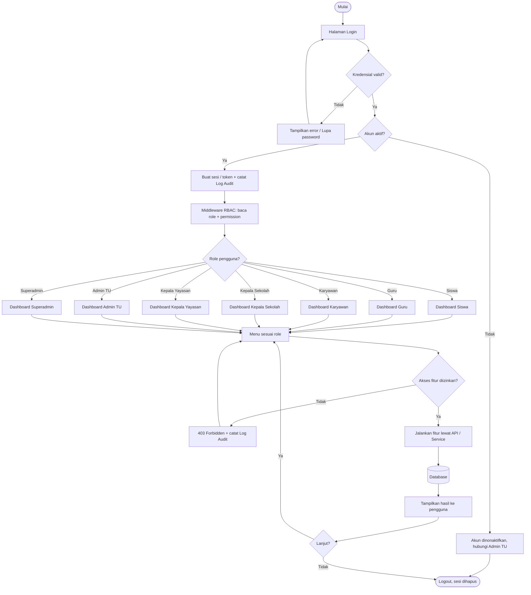

---

## 2. Alur Fitur per Role

### 2.1 Siswa

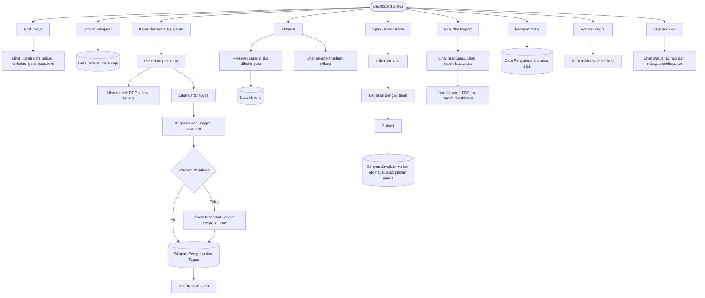

### 2.2 Guru

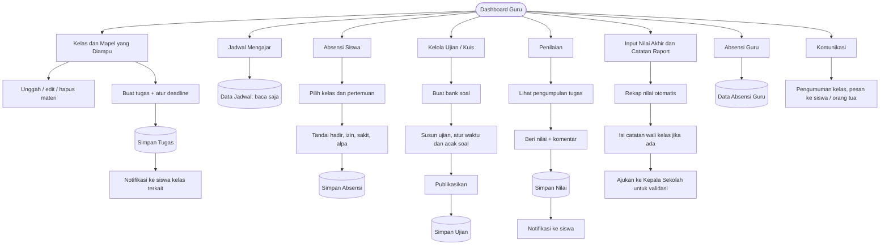

### 2.3 Karyawan

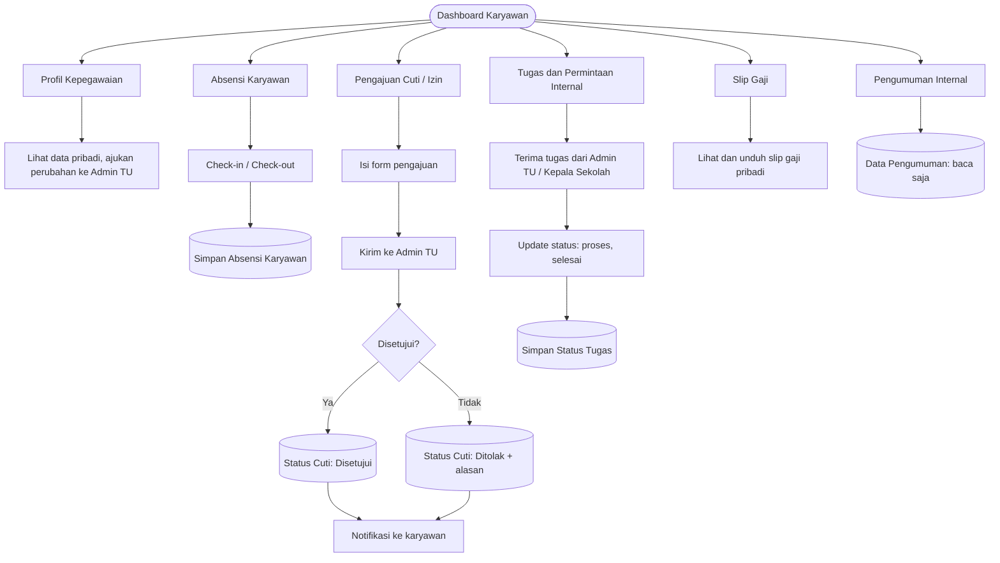

### 2.4 Kepala Sekolah

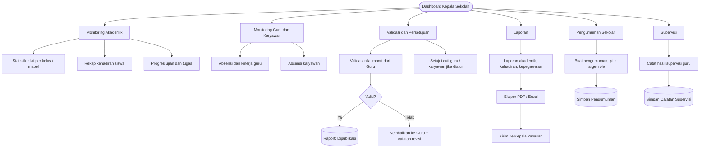

### 2.5 Kepala Yayasan

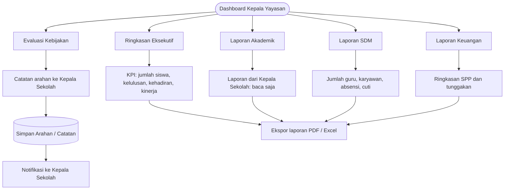

> Kepala Yayasan bersifat **read-only** pada data operasional. Hak tulis hanya pada catatan arahan.

### 2.6 Admin TU

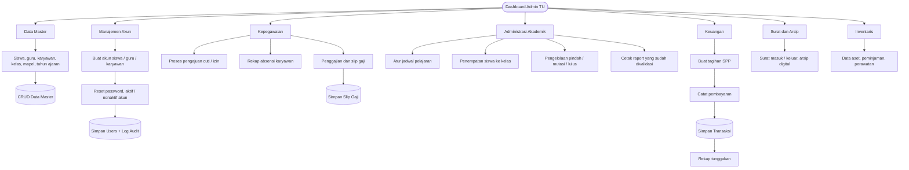

### 2.7 Superadmin

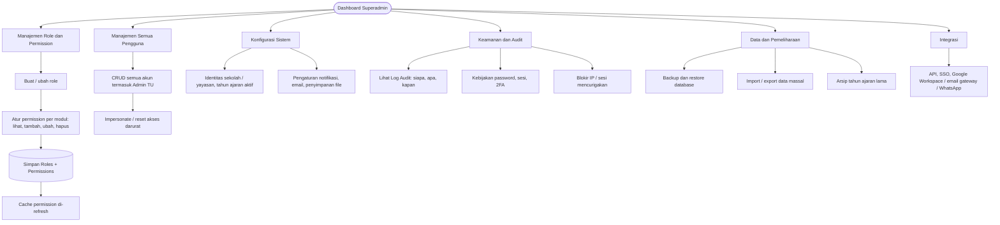

---

## 3. Alur Akses Data (Role, Service, Database)

### 3.1 Lapisan Akses

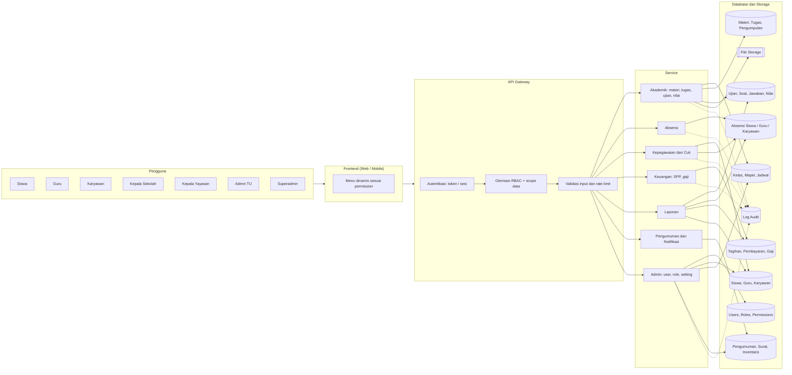

### 3.2 Aturan Scope Data (Row-Level)

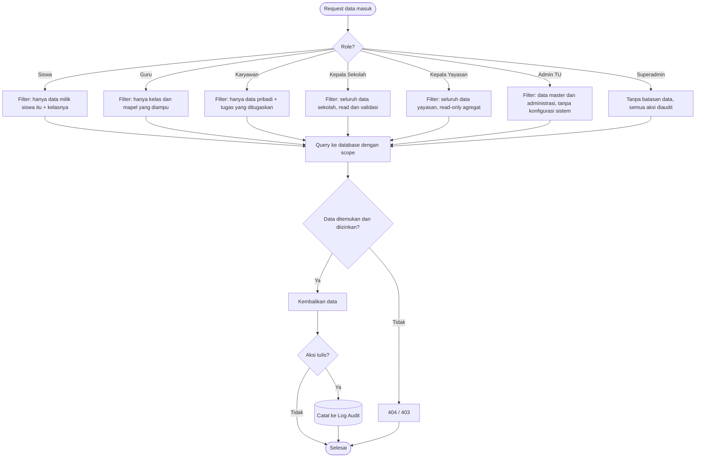

---

## 4. Matriks Hak Akses

Keterangan: **C** Create, **R** Read, **U** Update, **D** Delete, **V** Validasi/Setujui, **-** tidak ada akses, **(own)** hanya milik sendiri, **(kelas)** hanya kelas yang diampu.

| Data / Modul | Siswa | Guru | Karyawan | Kepsek | Ketua Yayasan | Admin TU | Superadmin |
|---|---|---|---|---|---|---|---|
| Profil & akun | R U (own) | R U (own) | R U (own) | R U (own) | R U (own) | CRUD | CRUD |
| Role & permission | - | - | - | - | - | - | CRUD |
| Data master (kelas, mapel, tahun ajaran) | R | R | - | R | R | CRUD | CRUD |
| Jadwal | R | R (own) | - | R | - | CRUD | CRUD |
| Materi | R | CRUD (kelas) | - | R | - | R | CRUD |
| Tugas & pengumpulan | CR (own) | CRUD (kelas) | - | R | - | R | CRUD |
| Ujian & soal | R, jawab | CRUD (kelas) | - | R | - | R | CRUD |
| Nilai | R (own) | CRU (kelas) | - | R, V | R (agregat) | R | CRUD |
| Raport | R (own) | CRU (kelas) | - | R, V | R | R, cetak | CRUD |
| Absensi siswa | R (own), presensi | CRU (kelas) | - | R | R (agregat) | R | CRUD |
| Absensi guru / karyawan | - | CR (own) | CR (own) | R | R (agregat) | CRUD | CRUD |
| Cuti / izin | - | CR (own) | CR (own) | V | R | R, V | CRUD |
| Tagihan SPP | R (own) | - | - | R | R (agregat) | CRUD | CRUD |
| Slip gaji | - | R (own) | R (own) | R | R (agregat) | CRUD | CRUD |
| Pengumuman | R | CR (kelas) | R | CRUD | R | CRUD | CRUD |
| Surat & arsip | - | - | - | R | - | CRUD | CRUD |
| Inventaris | - | - | R (jika relevan) | R | R | CRUD | CRUD |
| Laporan & ekspor | - | R (kelas) | - | R, ekspor | R, ekspor | R, ekspor | R, ekspor |
| Konfigurasi sistem | - | - | - | - | - | - | CRUD |
| Log audit | - | - | - | - | - | - | R |
| Backup & restore | - | - | - | - | - | - | CRUD |

---

## 5. Alur Proses Lintas Role

### 5.1 Siklus Tugas dan Nilai sampai Raport

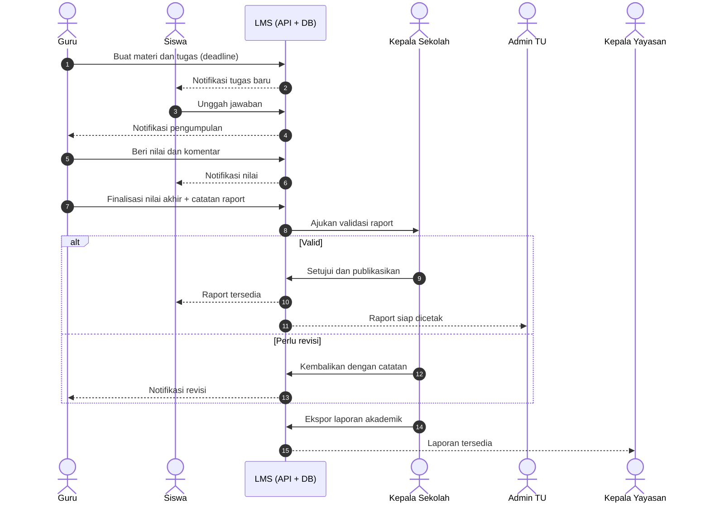

### 5.2 Pengajuan Cuti Karyawan / Guru

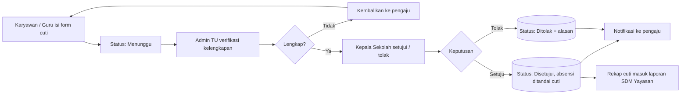

### 5.3 Pembuatan Akun dan Penentuan Hak Akses

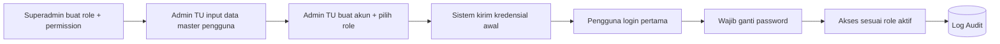

---

## 6. Fallback ASCII (Renderer-Agnostic)

### 6.1 Alur Umum

```
[Mulai]
   |
   v
[Halaman Login] <-----------------------------+
   |                                          |
   v                                          |
<Kredensial valid?> --Tidak--> [Pesan error]--+
   |
  Ya
   v
<Akun aktif?> --Tidak--> [Hubungi Admin TU] --> [Selesai]
   |
  Ya
   v
[Buat sesi/token + Log Audit]
   |
   v
[Middleware RBAC: baca role + permission]
   |
   v
<Role?>
   |-- Siswa ----------> [Dashboard Siswa] ---------+
   |-- Guru -----------> [Dashboard Guru] ----------+
   |-- Karyawan -------> [Dashboard Karyawan] ------+
   |-- Kepala Sekolah -> [Dashboard Kepsek] --------+--> [Menu sesuai role]
   |-- Kepala Yayasan -> [Dashboard Yayasan] -------+            |
   |-- Admin TU -------> [Dashboard Admin TU] ------+            v
   |-- Superadmin -----> [Dashboard Superadmin] ----+   <Akses diizinkan?>
                                                          |            |
                                                        Tidak         Ya
                                                          v            v
                                                   [403 + Audit]  [Service/API]
                                                                       |
                                                                       v
                                                                  [(Database)]
                                                                       |
                                                                       v
                                                              [Tampilkan hasil]
                                                                       |
                                                                       v
                                                                  [Logout]
```

### 6.2 Akses Data

```
 Siswa  Guru  Karyawan  Kepsek  Yayasan  Admin TU  Superadmin
   \      \      |        |       /        /         /
    +------+-----+--------+------+---------+---------+
                          |
                          v
                 [Frontend: menu dinamis]
                          |
                          v
        [API Gateway: Auth -> RBAC -> Validasi]
                          |
      +-----------+-------+--------+-----------+----------+
      v           v                v           v          v
  [Akademik]  [Absensi]  [Kepegawaian/Cuti] [Keuangan] [Laporan]
      |           |                |           |          |
      v           v                v           v          v
 (Materi,     (Absensi       (Guru,Karyawan, (Tagihan, (Agregat dari
  Tugas,       siswa/guru/    Cuti)           Gaji)     semua tabel)
  Ujian,       karyawan)
  Nilai)
                          |
                          v
                  (Log Audit: semua aksi tulis)

 Scope data:
   Siswa      -> data sendiri
   Guru       -> kelas/mapel yang diampu
   Karyawan   -> data sendiri + tugas
   Kepsek     -> seluruh sekolah (read + validasi)
   Yayasan    -> agregat (read-only)
   Admin TU   -> data master + administrasi
   Superadmin -> semua + konfigurasi (diaudit)
```

### 6.3 Siklus Tugas sampai Raport

```
Guru: buat tugas --> Siswa: kerjakan & unggah --> Guru: beri nilai
   --> Guru: finalisasi nilai akhir --> Kepsek: validasi
          |                                 |
          |                 +---------------+---------------+
          |                 v                               v
          |             [Valid]                       [Perlu revisi]
          |                 |                               |
          |      Raport dipublikasi                         |
          |        |            |                           |
          |        v            v                           |
          |   Siswa lihat   Admin TU cetak                  |
          |                                                 |
          +<------------------------------------------------+
                                  |
                      Kepsek ekspor laporan --> Yayasan
```
